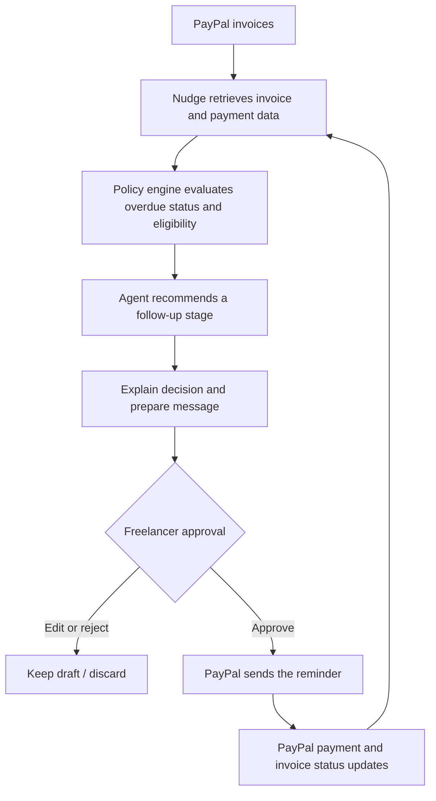
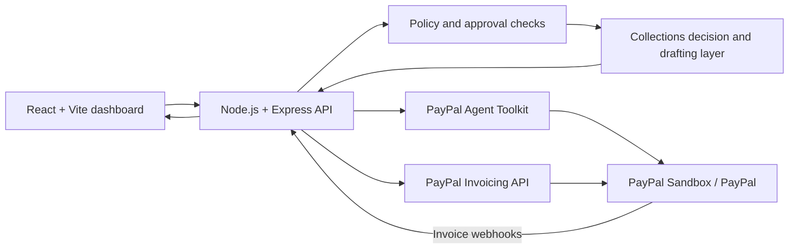

# Nudge — AI Collections Agent for Freelancers

**Collect overdue invoices with more confidence—and less awkwardness.**

Nudge is a human-in-the-loop collections agent for freelancers. It monitors unpaid PayPal invoices, evaluates how overdue each payment is, recommends an appropriate follow-up strategy, and prepares a personalized message for the freelancer to review. The freelancer remains in control: **no reminder is sent without explicit approval.** PayPal handles invoice actions and payment-status tracking.

<p align="center">
  <strong>Monitor → Decide → Explain → Approve → Follow up</strong>
</p>

## The problem

Freelancers regularly lose time and energy chasing late payments. A gentle nudge may be enough for a recently overdue invoice, while a payment that has been outstanding for weeks may need a firmer follow-up or a conversation about installments. Handling every client manually is repetitive—and getting the tone wrong can strain a professional relationship.

## The Nudge approach

Nudge turns invoice follow-up into a structured, reviewable workflow:

1. **Monitor invoices** — retrieve invoice details and payment status from PayPal.
2. **Evaluate overdue time** — assess how long an invoice has been unpaid.
3. **Recommend a strategy** — choose an appropriate follow-up stage from the application's policy rules.
4. **Explain the recommendation** — show why that approach is appropriate.
5. **Prepare a personalized draft** — create a message the freelancer can review and edit.
6. **Request approval** — send only after the freelancer explicitly approves.
7. **Track the outcome** — reflect payment and invoice updates from PayPal.

### Example follow-up strategy

| Situation | Possible approach |
|---|---|
| A few days overdue | Friendly, low-pressure reminder |
| Around one week overdue | Clear follow-up with the invoice details |
| Several weeks overdue | Firmer request and, where eligible, a suggested payment plan |

The exact action is governed by application policy and invoice eligibility—not by an unrestricted AI decision.

## Why it is different

- **Human approval by design:** the agent prepares actions; the freelancer decides whether to send them.
- **Policy-constrained decisions:** the application determines which follow-up stages are allowed before a recommendation is made.
- **Explainable recommendations:** each proposed follow-up includes a reason.
- **Financial guardrails:** calculations and payment-plan amounts are handled by application code, not invented by the language model.
- **PayPal-native workflow:** invoice operations use PayPal's Agent Toolkit and Invoicing API integration.
- **Fallback drafting:** if the configured language model is unavailable or returns invalid output, Nudge can fall back to safe templates.

## Product workflow



## PayPal integration

Nudge integrates with PayPal's invoice workflow. The dashboard's PayPal activity panel is intended to make tool activity visible rather than hiding payment operations behind a generic assistant response.

The integration includes these operations where supported by the configured PayPal environment:

- List invoices
- Retrieve invoice details
- Send invoice reminders
- Send invoices
- Record payment information
- Handle invoice-related webhook events

The application uses the PayPal Agent Toolkit for supported invoice actions and the PayPal Invoicing REST API for operations that require direct API calls. Test the exact operations against your own PayPal Sandbox app before presenting them as live in a demo.

## Architecture



## Tech stack

- **Frontend:** React, Vite
- **Backend:** Node.js, Express
- **Payments and invoicing:** PayPal Agent Toolkit, PayPal Invoicing API v2
- **AI drafting:** configurable Gemini integration with template fallback
- **Deployment:** Render

## Run locally

### Requirements

- Node.js and npm
- PayPal Developer Sandbox credentials for live sandbox integration
- A Gemini API key only if you want to enable the Gemini drafting provider

### 1. Install dependencies

From the repository root:

```bash
npm run install:all
```

### 2. Configure the server

Create `server/.env` from the example file:

```bash
# macOS / Linux
cp server/.env.example server/.env
```

On Windows PowerShell:

```powershell
Copy-Item server/.env.example server/.env
```

For a no-credentials local walkthrough, retain the mock settings from the example environment. For PayPal Sandbox, configure the following values in `server/.env`:

```env
PAYPAL_MODE=sandbox
PAYPAL_CLIENT_ID=your_sandbox_client_id
PAYPAL_CLIENT_SECRET=your_sandbox_client_secret
PAYPAL_TEST_PAYER_EMAIL=your_sandbox_personal_account_email

# Optional AI drafting provider
LLM_PROVIDER=gemini
GEMINI_API_KEY=your_gemini_api_key
GEMINI_MODEL=your_available_gemini_model_id

# Keep webhook verification fail-closed
PAYPAL_WEBHOOK_ID=
ALLOW_UNVERIFIED_WEBHOOKS=0
```

Do not commit `.env` files or publish API credentials. If the AI provider is not configured or temporarily unavailable, the application may use its template fallback.

### 3. Build and start

```bash
npm run build
npm start
```

Open **http://localhost:3001** (unless your environment specifies a different port).

### 4. Run checks

```bash
npm test
npm run preflight
npm run check:submission
```

For PayPal Sandbox-specific scripts, run them from the `server` directory:

```bash
cd server
npm run seed:sandbox
npm run smoke:paypal
```

Seeding creates test invoices in the PayPal Sandbox account configured in your environment. It does not create real customer invoices.

## Demo mode

Nudge includes a mock mode with sample invoice data so reviewers can explore the workflow without connecting PayPal credentials. The dashboard supports a simulated date and a simulated client-payment action for demonstrating overdue stages and payment updates. These are demo conveniences and should not be confused with real PayPal transactions.

## Deployment

A Render Blueprint configuration is included in `render.yaml`. See [`docs/DEPLOY.md`](docs/DEPLOY.md) for deployment details.

After deployment, configure the service's environment variables in Render. For a PayPal Sandbox deployment, set `PAYPAL_MODE=sandbox` and provide the Sandbox client ID, secret, and test payer email. If using Gemini, also set `LLM_PROVIDER=gemini` and `GEMINI_API_KEY`. Keep `ALLOW_UNVERIFIED_WEBHOOKS=0`.

For real webhook processing, register the deployed endpoint shown in the application configuration (currently `/api/webhooks/paypal`) in the PayPal Developer Dashboard, subscribe to the invoice events supported by the app, and set the resulting webhook ID as `PAYPAL_WEBHOOK_ID`. Without a configured webhook ID, real webhook signatures are rejected by design; the local/demo payment simulation is separate.

## Safety and limitations

- **Approval is mandatory:** a reminder is not sent until a human approves it.
- **Server-side revalidation:** the server checks the current policy again when an action is approved.
- **AI is advisory:** the model does not calculate or authorize financial amounts.
- **Sandbox first:** use PayPal Sandbox for development and judging demos; do not put production credentials in a public repository.
- **Webhook verification:** unverified webhooks are not accepted by default.
- **Demo state:** the current demo stores application state in memory; it can reset when the server restarts or a hosting instance sleeps/restarts.
- **Simulated overdue dates:** the demo can shift its displayed date to illustrate overdue scenarios. This does not change PayPal's actual invoice due date.
- **Provider availability:** external AI model availability and rate limits are outside Nudge's control; template fallback is available when configured model calls fail.

## Project status

Built for the **PayPal AI Hackathon**. The project demonstrates a freelancer-focused collections workflow with PayPal invoice integration and human-controlled follow-up actions. Features should be considered operational only to the extent verified in the deployed environment and current Sandbox configuration.

## License

This project is licensed under the [MIT License](LICENSE).
